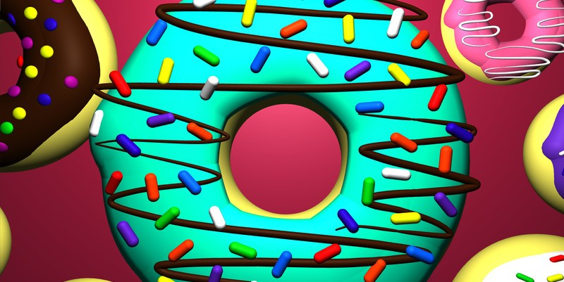

<h1 align="center">
  
</h1>

<p align="center">
  <a href="https://github.com/zhangxige"></a>
  <a href="https://zhangxige.github.io"></a>
  <a href="https://t.me/Wcowin"></a>
  <a href="mailto:daxuekanshijie@sina.cn"></a>
  <a href="https://gist.github.com/zhangxige"></a>
</p>

---

### 🙋 About Me

```text
🔭 Working on   : Exploring interesting Python packages to build useful software
⚡ Learning     : Rust to complement Python development
🎯 Focus area   : Digital Image IQA & software development
💬 Ask me about : Python / Rust / C++
```

> I enjoy studying the efficient usage of programming languages and building tools with them — from local utilities to full-stack apps. Feel free to reach out if you share this interest.

### 🛠️ Tech Stack

<p align="center">
  
  <br/>
  <sub>Proficient: Python · C++ &nbsp;|&nbsp; Learning: Rust · JavaScript · Vue</sub>
</p>

---

### 📊 GitHub Stats

<p align="center">
  
  
  <br/>
  
</p>

### 📌 Featured Projects

| Project | What it is |
| :-- | :-- |
| **[Python-UseFul](https://github.com/zhangxige/Python-UseFul)** | 常用 Python 工具与脚本合集 |
| **[Vue3-UseFul](https://github.com/zhangxige/Vue3-UseFul)** | Vue 3 实践与组件示例 |
| **[Image_Search_Tools](https://github.com/zhangxige/Image_Search_Tools)** | 图像搜索与图像质量评价工具 |
| **[zhangxige.github.io](https://github.com/zhangxige/zhangxige.github.io)** | 个人站点与技术笔记 |

---

### 🎨 Beyond Code

<p align="center">
  
  
  
</p>

<p align="center">
  🏂 Learn a new skill &nbsp;·&nbsp; 📸 Photograph &nbsp;·&nbsp; ✈️ Go on a trip
</p>

### 🎯 Now

```text
🎯 2026 : Good sleep · Learn something new every day · Do as I say
🔥 Diving : Nuxt — the intuitive Vue framework for modern web apps
📖 Blog   : Zensical 中文教程 → https://zhangxige.github.io
```

---

<p align="center">
  <a href="https://github.com/sponsors/zhangxige"></a>
  <a href="https://www.buymeacoffee.com/zhangxige"></a>
  <br/>
  
  <br/>
  <sub>Thanks for visiting! </sub>
</p>


